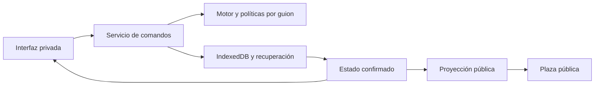

# Grimorio

[English](README.md) · **Español**

Asistente de Narrador para partidas presenciales de **Blood on the Clocktower**. Reúne preparación, personajes, fases, votaciones y notas en un dispositivo, con guardado local y funcionamiento offline tras la primera carga.

**[Probar la demo](https://juanmavillard.github.io/grimorio/)** · [Guía de uso](docs/manuales/general/guia-del-programa.md) · [Arquitectura](docs/tecnico/arquitectura.md)

**Idioma:** la interfaz y los manuales de juego están en español. La documentación de desarrollo principal está en inglés.

Proyecto personal de **Juanma Villard**, desarrollado con JavaScript, IndexedDB y Electron. No es una aplicación oficial de The Pandemonium Institute.

## Demo online

Abre la demo y prepara una partida con nombres ficticios. No requiere cuenta ni instalación. Los datos se guardan en tu navegador; no se comparten con otros visitantes. Para conservarlos o trasladarlos a otro equipo, exporta una copia JSON.

El funcionamiento offline requiere completar la primera carga. Para volver a empezar, puedes gestionar los datos desde Recuperación.

## Qué resuelve

Dirigir una partida implica coordinar reglas y cambios de estado sin revelar información secreta. El Grimorio ofrece preparación para 5–15 jugadores, reparto secreto en un dispositivo, noches guiadas, día y votaciones, historial y una Plaza pública que recibe solo los datos que puede mostrar.

Incluye Trouble Brewing, Bad Moon Rising y Sects & Violets, con 72 personajes. Las decisiones ambiguas siguen en manos del Narrador; las interacciones reglamentarias no están auditadas de forma exhaustiva.

## Probar en local

Con Python 3, desde la raíz del proyecto:

```bash
python3 -m http.server 4173 --bind 127.0.0.1
```

Abre `http://127.0.0.1:4173` y crea una partida con nombres ficticios. Detén el servidor con Ctrl+C. Con Node y npm, `npm start` hace lo mismo. No necesitas instalar dependencias para este uso web.

## Arquitectura y decisiones

JavaScript modular, HTML/CSS propios, IndexedDB, service worker y adaptación de escritorio con Electron. La web no tiene dependencias externas de ejecución, cuentas, sincronización remota ni telemetría.



| Decisión | Propósito | Código |
| --- | --- | --- |
| Comandos y políticas por guion | Separar acciones, reglas e interfaz | [Servicio](src/application/service.js), [guiones](src/core/scripts.js) |
| Guardar antes de publicar estado | Evitar mostrar como confirmado un cambio no guardado | [Almacenamiento](src/core/active-store.js) |
| Revisiones y transacciones | Rechazar operaciones basadas en un estado obsoleto | [Almacenamiento](src/core/active-store.js) |
| Validación y migraciones | Rechazar archivos corruptos y leer formatos anteriores | [Archivos](src/core/game-files.js), [migraciones](src/core/migrations.js) |
| Proyección pública | Mostrar la mesa sin roles, notas ni estados privados | [Motor](src/core/engine.js), [vista](src/ui/public-square.js) |
| Copias y recuperación | Deshacer/rehacer, restaurar y exportar datos | [Almacenamiento](src/core/active-store.js), [recuperación](src/ui/recovery.js) |

[Arquitectura detallada](docs/tecnico/arquitectura.md).

## Desarrollo y pruebas

Node **>=22.12.0**; versión comprobada **26.13.1** con npm **11.20.0**, fijada en `.nvmrc`. Python 3 para los servidores locales (comprobado: 3.15.2). Navegador moderno con JavaScript, IndexedDB y service workers. No se ha probado toda la matriz de versiones admitidas.

```bash
npm ci
npx playwright install chromium
npm run check
npm run test:browser:all
npm run test:demo
```

La validación del 20 de noviembre de 2026 supera **196 pruebas Node**, los recorridos Chromium de los tres guiones y Electron en desarrollo sobre Mac Apple Silicon. Incluye archivos, revisiones, fallos de cuota, deshacer/rehacer, recuperación, privacidad y actualización offline. Las pruebas usan datos ficticios y perfiles aislados. [Alcance y compatibilidad](docs/tecnico/calidad-y-compatibilidad.md).

Para escritorio desde fuentes: `npm run desktop:start`. [Construcción y plataformas](docs/tecnico/escritorio.md). Después de cambiar recursos de la app, ejecuta `npm run release:generate`; después de cambiar ayuda estructurada, `npm run docs:generate`. `npm run check` comprueba su coherencia.

## Límites y datos

- Una partida activa por origen y navegador; sin partidas remotas multiusuario, Viajeros, Fabled ni guiones arbitrarios importables.
- Auditorías de personajes e interacciones abiertas. Las pruebas de software no certifican todas las combinaciones de reglas. [Estado de cobertura](docs/tecnico/estado-de-cobertura.md).
- La primera carga web debe completarse antes del uso offline; no abrir como archivo HTML. `localhost`, `127.0.0.1` y distintos puertos tienen almacenamiento separado: exporta e importa la partida al cambiar de origen.
- Almacenamiento local sin cifrado de aplicación. Los archivos de partida contienen información privada; los diagnósticos se exportan anónimos por defecto.
- Ejecución real en Windows e Intel, Safari/iOS y accesibilidad manual siguen pendientes. La validación reciente de escritorio corresponde a ejecución desde fuentes en Mac Apple Silicon.

## Autoría, fuentes y licencia

Blood on the Clocktower pertenece a **The Pandemonium Institute**. Los personajes, habilidades y referencias reglamentarias proceden de la wiki oficial y otros recursos documentados en [Fuentes reglamentarias](docs/tecnico/fuentes-reglas.md). Este proyecto no implica afiliación ni aprobación del editor.

El código se distribuye como `UNLICENSED`. Los materiales de TPI y las dependencias mantienen sus condiciones respectivas. [Avisos de terceros](THIRD_PARTY_NOTICES.md) · [Recursos y atribuciones](docs/tecnico/atribuciones.md).

## Documentación

[Guía del programa](docs/manuales/general/guia-del-programa.md) · [Guardado y recuperación](docs/manuales/general/guardado-y-recuperacion.md) · [Índice completo](docs/README.md) · [Desarrollo y mantenimiento](CONTRIBUTING.md)
