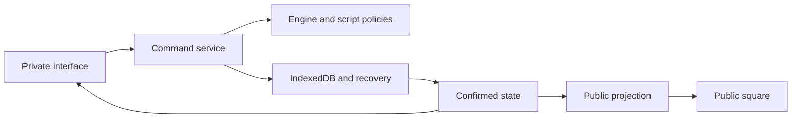

# Grimorio

**English** · [Español](README.es.md)

An offline Storyteller companion for in-person **Blood on the Clocktower** games. Manage setup, characters, phases, votes and notes on one device, with local persistence and offline access after the first complete load.

**[Try the web demo](https://juanmavillard.github.io/grimorio/)** · [Architecture](docs/tecnico/arquitectura.md) · [User guide (Spanish)](docs/manuales/general/guia-del-programa.md)

A personal project by **Juanma Villard**, built with JavaScript, IndexedDB and Electron. This is an unofficial project, independent of The Pandemonium Institute.

**Language:** the application interface, character guidance and player guides are currently available in **Spanish**. The main development documentation is in English.

## Try it

Open the demo and create a game with fictional player names. No account or installation is required. Game data stays in your browser and is not shared with other visitors. Export a JSON backup to keep a copy or move to another device.

Offline use requires a complete initial load. Use the application's recovery screen, labelled **Recuperación**, to manage stored data.

## What it does

Running a game involves coordinating rules and state changes while keeping secret information private. Grimorio supports setup for 5–15 players, secret role dealing on a shared device, guided nights, daytime nominations and voting, history, and a public view built from a restricted projection of game data.

It includes **Trouble Brewing, Bad Moon Rising and Sects & Violets**, covering 72 characters. Ambiguous decisions remain with the Storyteller; character interactions have not been exhaustively audited.

## Run locally

With Python 3, from the project root:

```bash
python3 -m http.server 4173 --bind 127.0.0.1
```

Open `http://127.0.0.1:4173` and create a game with fictional names. Stop the server with Ctrl+C. If Node and npm are installed, `npm start` runs the same server. Installing development dependencies is not required to serve the web application this way.

## Architecture and decisions

Modular JavaScript, HTML/CSS, IndexedDB, a service worker and an Electron desktop wrapper. The web application has no external runtime dependencies, accounts, remote synchronisation or telemetry.



| Decision | Purpose | Code |
| --- | --- | --- |
| Commands and script policies | Separate actions, rules and presentation | [Service](src/application/service.js), [scripts](src/core/scripts.js) |
| Persist before publishing state | Avoid presenting an unsaved change as confirmed | [Repository](src/core/active-store.js) |
| Revisions and transactions | Reject actions based on stale state | [Repository](src/core/active-store.js) |
| Validation and migrations | Reject corrupt files and read older formats | [Game files](src/core/game-files.js), [migrations](src/core/migrations.js) |
| Public projections | Show the table without secret roles, notes or private states | [Engine](src/core/engine.js), [view](src/ui/public-square.js) |
| Undo and recovery | Restore earlier state and export backups | [Repository](src/core/active-store.js), [recovery](src/ui/recovery.js) |

[Detailed architecture](docs/tecnico/arquitectura.md).

## Development and testing

Node **>=22.12.0**; tested with **26.13.1** and npm **11.20.0**. `.nvmrc` pins the tested Node version. Python 3 is used for local servers (tested: 3.15.2). The browser needs JavaScript, IndexedDB and service workers. Not every supported runtime version has been tested.

```bash
npm ci
npx playwright install chromium
npm run check
npm run test:browser:all
npm run test:demo
```

Validation on **20 November 2026** passed **196 Node tests**, Chromium workflows for all three scripts, and Electron development workflows on Apple Silicon Mac. Coverage includes files, revisions, storage quota failures, undo/redo, recovery, privacy and offline updates. Tests use fictional data and isolated profiles. [Testing scope and compatibility](docs/tecnico/calidad-y-compatibilidad.md).

Run the desktop application from source with `npm run desktop:start`. [Desktop builds and platforms (Spanish)](docs/tecnico/escritorio.md). See [CONTRIBUTING](CONTRIBUTING.md) for the development workflow.

## Limitations and data

- One active game per browser origin; no remote multiplayer, Travellers, Fabled or arbitrary imported scripts.
- Rules and character-interaction audits remain open. Software tests do not certify every rules combination. [Rules coverage (Spanish)](docs/tecnico/estado-de-cobertura.md).
- Complete the first load before using the web application offline. Do not open the HTML file directly. `localhost`, `127.0.0.1` and different ports use separate storage: export and import your game when switching origins.
- Local storage is not encrypted by the application. Game exports contain private information; diagnostics are anonymous by default.
- Real Windows and Intel Mac execution, Safari/iOS and manual accessibility checks remain pending. Recent desktop validation covers execution from source on Apple Silicon Mac.

## Credits and licence

Blood on the Clocktower belongs to **The Pandemonium Institute**. Characters, abilities and rules references are based on the official wiki and other documented [rules sources (Spanish)](docs/tecnico/fuentes-reglas.md). This project does not imply affiliation with or approval by the publisher.

The code is marked `UNLICENSED`. TPI materials and dependencies retain their respective conditions. [Third-party notices](THIRD_PARTY_NOTICES.md) · [Resources and credits](docs/tecnico/atribuciones.md).

## Documentation

[Documentation index](docs/README.md) · [Development guide](CONTRIBUTING.md) · [Project structure](docs/tecnico/organizacion-del-proyecto.md) · [User guide (Spanish)](docs/manuales/general/guia-del-programa.md) · [Saving and recovery (Spanish)](docs/manuales/general/guardado-y-recuperacion.md)
