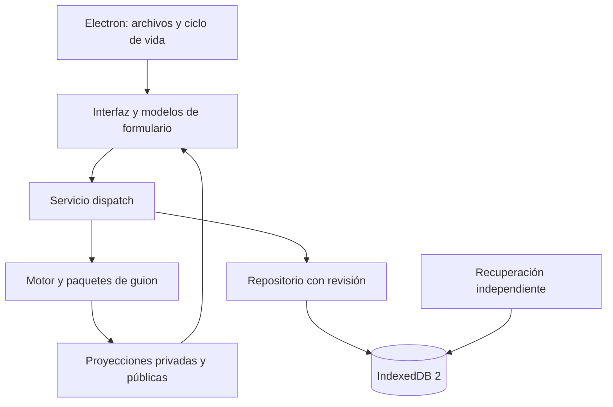

# Arquitectura

## Sistema y límites

Grimorio privado es una aplicación local: JavaScript modular, tres paquetes Base 3, interfaz web y envoltura Electron. No hay un servidor de negocio. En navegador, el servidor local solo entrega archivos; Electron entrega los recursos del paquete desde `grimorio://app/`.

## Responsabilidades y contratos

| Capa | Autoridad y responsabilidad |
| --- | --- |
| Interfaz | Presentación, foco y borradores. No modifica la partida confirmada. |
| Aplicación | Recibe comandos de datos, prepara una copia, valida, confirma decisiones y publica tras guardar. |
| Motor y guiones | Fases, jugadores, muertes, estados y resolución reglamentaria. Sin DOM ni almacenamiento. |
| Repositorio | Estado confirmado, revisión, transacciones, deshacer y recuperación. |
| Proyecciones | Datos públicos por lista cerrada, diagnóstico anónimo y ventanas de historial. |
| Escritorio | Recursos propios, puente limitado de archivos, instancia única y cierre seguro. |
| PWA | Conjunto coherente de recursos versionados, independiente de IndexedDB. |

`dispatch(command)` captura la revisión antes de entrar en su cola. Pasa `expectedRevision` a todas las escrituras. El repositorio comprueba esa revisión al empezar la operación serializada y compara el registro guardado dentro de la transacción. Una cancelación, validación fallida, cuota o conflicto conserva el estado anterior. Las funciones antiguas de persistencia mantienen sus firmas con opciones adicionales; las pantallas usan comandos.

Las decisiones nocturnas contienen `information` y `decisions`, no selectores HTML. La interfaz convierte controles en esos datos; cambiar un identificador del DOM no altera el contrato del motor.

## Fuente de verdad

| Datos | Autoridad |
| --- | --- |
| Partida confirmada | Repositorio; JSON de partida 4. |
| Borradores | Modelos sin confirmar y campos por formulario, pestaña y revisión. |
| Historial | Explica hechos; no reconstruye las reglas buscando textos. |
| Recordatorios derivados | Se calculan desde los estados y efectos de origen. |
| Recordatorios narrativos | Marcadores privados editables. |
| Preferencias | Almacenamiento pequeño e independiente de la partida. |
| Plaza y hojas para jugadores | Proyecciones públicas que excluyen datos privados de una partida. |

La preparación recupera el modelo antes de dibujar: guion, reparto, nombres, título, preferencias de preparación y reparto secreto. La asignación distingue personajes ya confirmados de decisiones pendientes. Noche, voto y ficha conservan campos sin aplicar habilidades al restaurarlos. Una revisión diferente requiere revisión explícita del borrador.

## Datos y recuperación

IndexedDB 2 contiene `state` y `drafts`. `state.active` incluye partida, revisión, deshacer, rehacer, recuperación y originales dañados. Se conservan como máximo diez instantáneas por pila y tres puntos dentro de 2 MiB auxiliares. Nunca se recorta el historial activo para cumplir ese presupuesto.

El rescate independiente lee estado y borradores en una transacción de lectura, añade las preferencias y claves heredadas y conserva por separado los borradores solo en memoria. No importa el motor ni inicializa una partida sobre un registro corrupto. La limpieza explícita conserva la partida activa, verifica revisión y comunica el resultado a otras pestañas. Sus operaciones pendientes bloquean un cierre normal de escritorio.

El formato JSON sigue en 4. La validación actual no convierte textos inválidos en información ficticia; las reparaciones por defecto pertenecen a las migraciones documentadas de v1-v3. La duplicación heredada `history/events` se admite; al guardar se omite la segunda copia si ambas son iguales y se repone al leer.

## Paquetes de guion

Cada guion declara catálogo, composición, despertares y políticas de preparación, habilidad, información, noche, día y muerte. El motor coordina hechos y consulta excepciones del paquete. Las fachadas cortas conservan las exportaciones históricas. Mover archivos no introduce una migración.

Las muertes distinguen intento, supervivencia, muerte y registro especial. Las transformaciones limpian efectos y registran antes/después. Las decisiones ambiguas se mantienen privadas y explícitas. La corrección avanzada registra un ajuste con motivo; no pretende resolver una habilidad.

## Interfaz, privacidad y rendimiento

El temporizador actualiza su contador sin reconstruir formularios. Los diálogos propios admiten teclado y se retiran del documento al entrar en Plaza/Tapar. La Plaza recibe únicamente su proyección. La revelación requiere resultado confirmado.

El historial muestra 50 registros por página y reutiliza su proyección por instantánea; los registros completos siguen disponibles al exportar. Las pruebas extensas miden tamaño y latencia. No se introduce almacenamiento incremental en esta versión.

## Recursos y plataformas

La PWA instala un conjunto con huellas y espera un momento seguro para activar una actualización. Electron no registra ese worker: utiliza los recursos incluidos. Mantiene identificador, origen y perfil al sustituir la aplicación. El renderer no tiene Node ni acceso directo al disco.

Consulta [escritorio](escritorio.md), [calidad y compatibilidad](calidad-y-compatibilidad.md) e [inventario de módulos](inventario-modulos.md). Las limitaciones vigentes se recogen en cobertura y compatibilidad.

La [organización del proyecto](organizacion-del-proyecto.md) distingue código activo, compatibilidad, herramientas y resultados generados. Los programas de dist y las entregas de output son productos de construcción; el perfil local sigue siendo la única ubicación de la partida confirmada.
