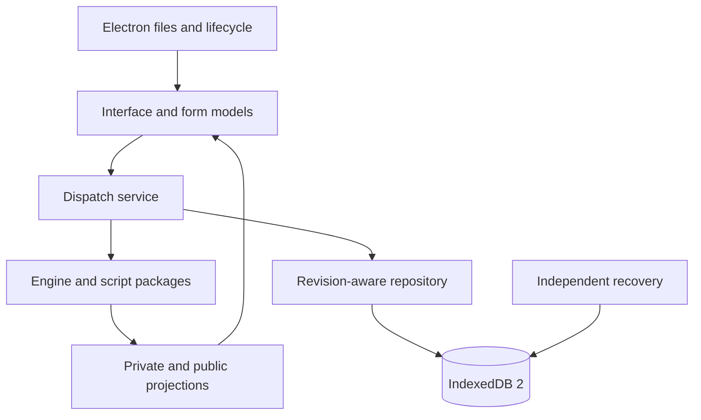

# Architecture

## System boundaries

Grimorio is a local application: modular JavaScript, three Base 3 script packages, a web interface and an Electron wrapper. There is no business backend. The browser's local server only serves files; Electron serves packaged resources through `grimorio://app/`.

## Responsibilities and contracts

| Layer | Authority and responsibility |
| --- | --- |
| Interface | Presentation, focus and drafts; does not mutate confirmed game state. |
| Application | Receives data commands, prepares a copy, validates, confirms decisions and publishes after saving. |
| Engine and scripts | Phases, players, deaths, states and rules; no DOM or storage access. |
| Repository | Confirmed state, revisions, transactions, undo and recovery. |
| Projections | Allowlisted public data, anonymous diagnostics and history windows. |
| Desktop | Packaged resources, restricted file bridge, single instance and coordinated shutdown. |
| PWA | A coherent set of versioned resources, independent of IndexedDB. |

`dispatch(command)` captures the revision before entering its queue and passes `expectedRevision` to writes. The repository checks that revision when starting the serialised operation and compares the stored record within the transaction. Cancellation, validation errors, quota failures and conflicts preserve the previous state. Legacy persistence functions retain their signatures with additional options; screens use commands.

Night actions contain `information` and `decisions`, not HTML selectors. The interface converts controls into those data structures, so a DOM identifier change does not alter the engine contract.

## Sources of truth

| Data | Authority |
| --- | --- |
| Confirmed game | Repository; game JSON schema 4. |
| Drafts | Unconfirmed models and fields per form, tab and revision. |
| History | Describes facts; rules are not reconstructed by searching log text. |
| Derived reminders | Computed from states and their originating effects. |
| Storyteller reminders | Editable private markers. |
| Preferences | Small storage separate from the game. |
| Public square and player sheets | Public projections excluding private game data. |

Setup restores its model before rendering: script, roles, names, title, setup preferences and secret dealing. Assignment distinguishes confirmed characters from pending decisions. Night, voting and player forms restore fields without applying abilities. A different revision requires an explicit draft review.

## Persistence and recovery

IndexedDB version 2 contains `state` and `drafts`. `state.active` includes the game, revision, undo, redo, recovery points and damaged originals. Each undo/redo stack holds up to ten snapshots; recovery holds up to three points, within a 2 MiB auxiliary budget. Active history is never truncated to meet that budget.

Independent recovery reads state and drafts in a read transaction, adds preferences and legacy keys, and preserves memory-only drafts separately. It does not import the engine or initialise a game over a corrupt record. Explicit cleanup preserves the active game, checks the revision and notifies other tabs. Pending recovery operations block normal desktop shutdown.

The game JSON schema remains version 4. Validation does not turn invalid text into invented history; default repairs belong to the documented v1–v3 migrations. Legacy `history/events` duplication is supported: when both are identical, the second copy is omitted on save and restored on read.

## Script packages

Each script declares its catalogue, composition, night order and policies for setup, abilities, information, night, day and death. The engine coordinates facts and consults package-specific exceptions. Small facade modules preserve historical exports; moving a file does not imply a data migration.

Deaths distinguish attempts, survival, actual death and special registration. Transformations clear effects and record before/after state. Ambiguous decisions remain private and explicit. Advanced corrections record a reason rather than pretending to resolve an ability.

## Interface, privacy and performance

The timer updates its counter without rebuilding forms. Custom dialogs support keyboard use and are removed when entering the public square or privacy screen. The square receives only its public projection. Revealing roles requires a confirmed outcome.

History shows 50 entries per page and reuses projections for a given snapshot. Full history remains available in exports. Long-game workflows measure size and latency; this version does not introduce incremental storage.

## Resources and platforms

The PWA installs a resource set with hashes and waits for a safe point before activating an update. Electron does not register that worker: it uses bundled resources. Replacing the application preserves identity, origin and profile. Its renderer has neither Node integration nor direct disk access.

See [testing and compatibility](calidad-y-compatibilidad.md), [desktop builds (Spanish)](escritorio.md) and the [module inventory (Spanish)](inventario-modulos.md). Current platform and rules limitations are documented separately.

[Project structure](organizacion-del-proyecto.md) distinguishes source, compatibility modules, tools and generated outputs. Packages in dist and output are build products; confirmed game data stays in the local profile.
